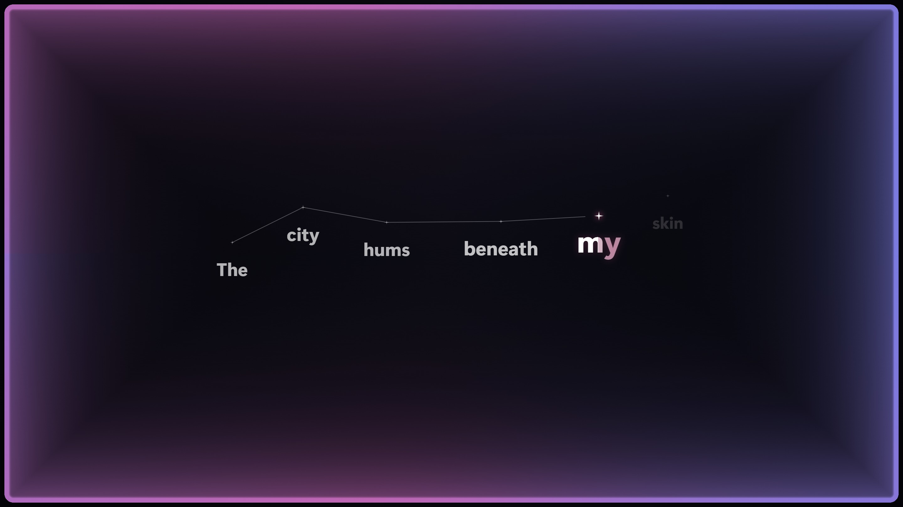
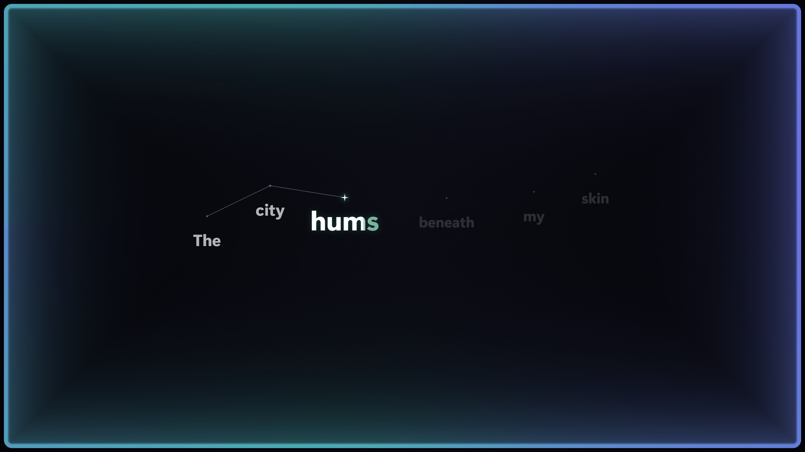

# Glowverse

An ambient desktop overlay for Windows: a thin, breathing rim of light around the edges of the screen, colored by the album art of whatever is playing, with the lyrics drifting across the middle of an otherwise empty desktop.



No window, no chrome, no widget. Just light and words, sitting above everything and passing every click through to the desktop underneath.

## What it does

- **Rim glow.** A WebGL2 shader draws a rounded, soft-edged line around the screen with an exponential inward falloff. Energy from the music opens the glow; nothing snaps.
- **Album art colors.** Artwork is downsampled to 64 px and reduced to two vivid, distinct colors, clamped so they stay luminous but never wash out to white. New tracks crossfade in OKLab over 800 ms.
- **YT Music, without an account.** A Manifest V3 extension reads the page's media session and video element and posts it to a loopback bridge inside the app. Nothing leaves the machine.
- **Synced lyrics.** LRCLIB is queried by title, artist, album and duration, with cleaned titles, a search fallback and a disk cache. Line timing is turned into word timing by syllable weight.
- **Constellation lyric style.** Each line becomes a small constellation: sung words settle back, the current word is large with a star node, and a thin line draws through the words as they are sung.
- **Honest fallbacks.** No synced lyrics means rim only. No audio means a slow breathing idle glow. Nothing on the overlay is ever an error message.

## Screenshots

The lyric layer, with a sung phrase settling behind the current word:



> Both images are frames of the real `RimRenderer` and `LyricStage` (no mockups), captured with Glowverse's own bundled demo track, so no third-party lyrics appear anywhere in this repository.

## Requirements

- Windows 10 or 11 (macOS is planned, but not verified yet)
- Node.js 20 or newer
- Chrome or Edge 116+ for the YT Music bridge

## Quick start

```bash
npm install
npm run dev
```

The overlay appears on every display and the tray icon holds the controls: **Open Glowverse**, **Show lyrics**, **Pause overlay**, **Quit**. Open Glowverse to see the settings window, which also carries the pairing token.

Hold off on moving the mouse to the screen edge: the overlay is mouse-transparent, so clicks land on whatever is behind it.

## Connect YT Music

1. Start Glowverse and open the settings window from the tray.
2. Copy the pairing token with the **Copy** button.
3. Load the extension: `chrome://extensions` → enable **Developer mode** → **Load unpacked** → pick the `extension/` folder in this repo.
4. Press the Glowverse icon in the toolbar, paste the token, and save.
5. Play something on [music.youtube.com](https://music.youtube.com). The rim takes the colors of the album art, and lyrics appear once they are found.

The bridge binds `127.0.0.1` only, on the first free port in `47654–47658`. It accepts requests carrying the pairing token, and it pins itself to the first extension origin it sees, so another origin cannot take over an already-paired session. Regenerating the token in settings clears the pin.

## Lyrics

- Provider chain: LRCLIB exact match → LRCLIB search → nothing. Results, including misses, are cached on disk with an expiry (hits 30 days, misses 24 hours).
- Queries are cleaned first: `feat.` tags, remaster/live/version suffixes and bracket noise are stripped, and duets credited with "and" fall back to the lead artist.
- Line timing becomes word timing: each line's window is split by syllable weight, and every word highlight starts about 60 ms early so it feels in sync.
- Duration tolerance is deliberately tight (3 seconds). A live or extended upload with a different runtime shows rim only rather than misaligned words.
- Lyrics never block rendering, never appear in logs, and are never stored in the repository.

Cache location: `%APPDATA%/Glowverse/lyrics/lyrics-cache.json` (metadata and lines, on your machine only).

## Settings

Available today: overlay on/off, lyrics on/off, motion mode (beat sync, idle, off), palette (auto from album art or two custom colors), glow, thickness, corner radius, lyric size, per-track lyric offset in 100 ms steps, and the pairing token.

Still to come with M6–M9: source order, Spotify client ID, lyric style picker, font and position, per-display selection, start at login, and the global hotkey.

## Commands

| Command | What it does |
| --- | --- |
| `npm run dev` | Run the app with hot reload |
| `npm run build` | Typecheck, then build main, preload and renderer bundles |
| `npm start` | Preview a production build |
| `npm run typecheck` | TypeScript only, no emit |
| `npm run test:brightness` | Check the rim against the photosensitivity rule (≤10 % brightness change, ≤3 times per second) |
| `npm run test:lyrics` | Run the lyric cleaning, LRC parsing, provider and cache tests |

## Project layout

```
src/main/            Electron main process
  bridge/            Loopback HTTP bridge for the browser extension
  lyrics/            LRCLIB service and disk cache
  art/               Album art download and color extraction
  demo/              Bundled demo tracks and the demo clock
  overlayManager.ts  One overlay window per display
  settingsWindow.ts  Settings window and preload API
src/renderer/
  overlay/           Rim shader, energy, palette, lyric stage
    lyrics/          Constellation style and layout
  settings/          Settings UI
src/shared/          Settings model, master clock, now playing types, lyric parsing
extension/           MV3 extension for music.youtube.com
```

The lyric modules under `src/shared/lyrics` and `src/main/lyrics` do not import Electron, so they can be tested with plain Node.

## Privacy

- No microphone capture, ever. Only system output audio, and only for beat detection.
- No audio is recorded, stored or sent anywhere.
- Playback metadata crosses one hop: `extension → 127.0.0.1`. Lyrics requests go to LRCLIB and nothing else.
- The pairing token lives in the settings JSON under the Electron `userData` folder and is never bundled or logged.

## Status

| Milestone | |
| --- | --- |
| M0 Scaffold: app, tray, settings, overlay per display | done |
| M1 Rim shader with demo energy and palette crossfades | done |
| M2 Master clock, word timing, Constellation style | done |
| M3 YT Music extension, local bridge, album art colors | done |
| M4 LRCLIB lyrics with cache and title cleaning | done |
| M5 Loopback beat detection | next |
| M6 Source manager and the SMTC adapter | |
| M7 Spotify Web API adapter | |
| M8 Fisheye, Kinetic Stack and Thread styles | |
| M9 Settings polish, hotkey, installers | |
| M10 Performance and QA pass | |

Until M5 lands, the rim is driven by the tempo of a bundled demo track instead of the real audio.

### Known issues

- The rim's color drift is computed from `atan2`, which wraps at the middle of the left edge. A faint seam is visible there; it will be replaced with a wrap-free parameterization.
- Covering a paused YT Music session for more than ~15 seconds can fall back to the demo track, because a paused page throttles the extension's timer.

## License

MIT.
